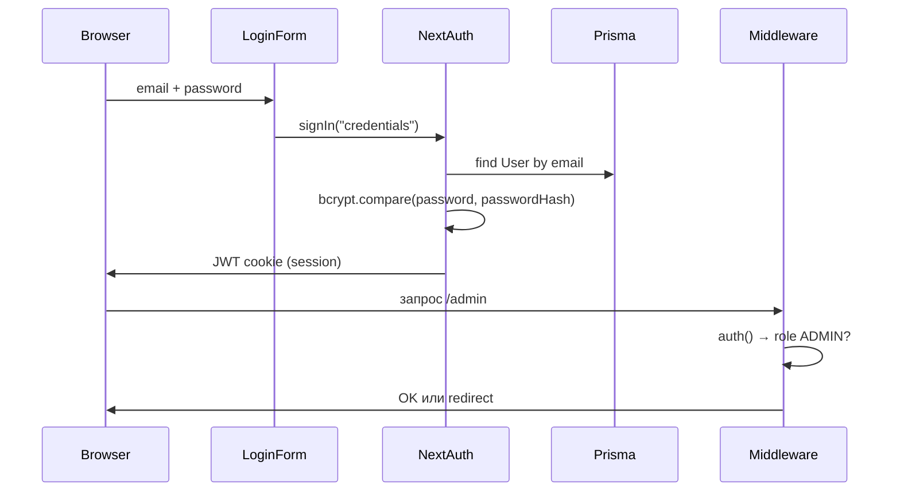

# Авторизация Wheels

> Меры безопасности и аудит QA: **[SECURITY.md](./SECURITY.md)**

Стек: **Auth.js (NextAuth v5)** + **Credentials** (email + пароль) + **JWT-сессии** + **bcrypt** (12 rounds).

Конфигурация: `src/auth.ts`  
Middleware: `src/middleware.ts`  
API route: `src/app/api/auth/[...nextauth]/route.ts`

## Схема входа



## Переменные окружения

| Переменная | Обязательна | Описание |
|------------|-------------|----------|
| `AUTH_SECRET` | **Да** | Секрет подписи JWT. `openssl rand -base64 32` |
| `AUTH_URL` | **Да** | Базовый URL приложения, напр. `http://localhost:3000` |
| `DATABASE_URL` | **Да** | Без БД `authorize()` не найдёт пользователя |
| `ALLOW_REGISTRATION` | Нет | `false` — отключить регистрацию (production) |

Если `AUTH_SECRET` пустой или сменился — старые cookies недействительны (выйдите и войдите снова).

`AUTH_URL` должен **совпадать** с URL в браузере (включая порт). Если dev на `3001`, укажите `http://localhost:3001`.

## Роли и маршруты

| Роль | Доступ | После входа |
|------|--------|-------------|
| `ADMIN` | `/admin/*` | Редирект на `/admin` |
| `EMPLOYEE` | `/employee/*` | Редирект на `/employee` |

**Middleware:**

- Неавторизованный → `/login?callbackUrl=...`
- ADMIN на `/employee` → `/admin`
- EMPLOYEE на `/admin` → `/employee`
- Публичные: `/login`, `/register`, `/api/auth/*`

## Что попадает в сессию

```ts
session.user = {
  id: string;
  email: string;
  name: string;
  role: "ADMIN" | "EMPLOYEE";
  employeeProfileId?: string; // только у сотрудников с профилем
}
```

На клиенте: `useSession()` из `next-auth/react` (см. `Topbar`).  
На сервере: `await auth()` в Server Components и Server Actions.

## Регистрация

`POST` через Server Action `registerUser` (`src/features/auth/actions.ts`):

- Создаёт `User` с ролью **EMPLOYEE** по умолчанию
- Автоматически создаёт `EmployeeProfile`
- **Не создаёт админов** — роль ADMIN только через seed или правку БД

## Создать админа вручную

### Вариант 1 — seed (рекомендуется)

```bash
npm run db:seed
```

Логин: `admin@wheels.local` / `password123`

### Вариант 2 — Prisma Studio

```bash
npm run db:studio
```

Откройте таблицу `User`, найдите пользователя, поле `role` → `ADMIN`.

### Вариант 3 — SQL

```sql
UPDATE "User" SET role = 'ADMIN' WHERE email = 'your@email.com';
```

## Почему «не пускает под админом»

| Симптом | Причина | Решение |
|---------|---------|---------|
| «Неверный email или пароль» | Нет пользователя или неверный пароль | `npm run db:seed`, проверьте email |
| Ошибка 500 на `/login` | БД недоступна | `npm run db:check`, см. TROUBLESHOOTING |
| Вход есть, но кидает на `/employee` | `role` не ADMIN | Обновить роль в БД |
| Вход «успешен», страницы пустые/ошибки | Prisma не подключается | Поднять PostgreSQL, `db:push` |

## Файлы авторизации

| Файл | Назначение |
|------|------------|
| `src/auth.ts` | Провайдер Credentials, callbacks JWT/session |
| `src/middleware.ts` | Защита маршрутов по роли |
| `src/features/auth/login-form.tsx` | Форма входа (клиент) |
| `src/features/auth/register-form.tsx` | Регистрация сотрудника |
| `src/features/auth/actions.ts` | `registerUser` server action |
| `src/shared/lib/validators.ts` | `loginSchema`, `registerSchema` |

## Выход

Кнопка в `Topbar` → `signOut({ callbackUrl: "/login" })`.
