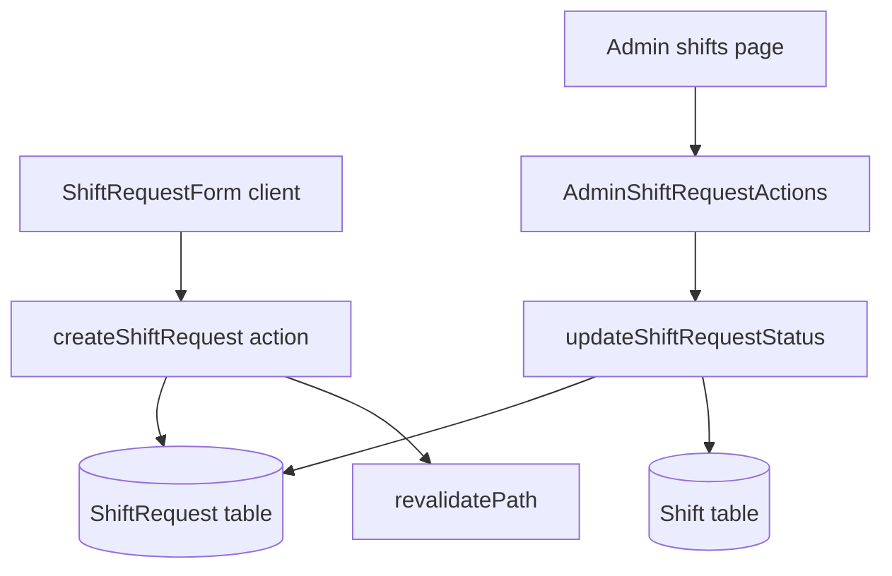

# Компоненты и структура проекта Wheels

## Дерево каталогов

```
projects/wheels/
├── prisma/
│   ├── schema.prisma      # модели БД
│   └── seed.ts            # тестовые данные + админ
├── src/
│   ├── app/               # маршруты Next.js (App Router)
│   ├── auth.ts            # Auth.js
│   ├── middleware.ts      # защита URL
│   ├── entities/          # мелкие UI-блоки предметной области
│   ├── features/          # бизнес-фичи (формы, actions)
│   ├── widgets/           # крупные блоки UI (layout, графики)
│   ├── services/          # серверная логика (агрегации)
│   └── shared/            # ui, lib, store, providers
├── docs/                  # документация
├── scripts/check-db.mjs   # проверка БД
├── docker-compose.yml
├── Dockerfile
└── .env.example
```

## Маршруты (`src/app/`)

| URL | Файл | Кто видит | Назначение |
|-----|------|-----------|------------|
| `/` | `page.tsx` | все | Редирект на `/admin` или `/employee` |
| `/login` | `(auth)/login/page.tsx` | гости | Вход |
| `/register` | `(auth)/register/page.tsx` | гости | Регистрация сотрудника |
| `/employee` | `(dashboard)/employee/page.tsx` | EMPLOYEE | Личный кабинет, сводка |
| `/employee/schedule` | `.../schedule/page.tsx` | EMPLOYEE | Календарь своих смен |
| `/employee/requests` | `.../requests/page.tsx` | EMPLOYEE | Заявки на смены + форма |
| `/employee/earnings` | `.../earnings/page.tsx` | EMPLOYEE | Выплаты и история |
| `/admin` | `(dashboard)/admin/page.tsx` | ADMIN | Dashboard, KPI |
| `/admin/employees` | `.../employees/page.tsx` | ADMIN | Таблица сотрудников |
| `/admin/shifts` | `.../shifts/page.tsx` | ADMIN | Заявки + календарь всех смен |
| `/admin/finances` | `.../finances/page.tsx` | ADMIN | Выручка, расходы, зарплаты |
| `/admin/analytics` | `.../analytics/page.tsx` | ADMIN | Графики Recharts |
| `/api/auth/*` | `api/auth/[...nextauth]/route.ts` | API | Auth.js handlers |

Общий layout дашборда: `(dashboard)/layout.tsx` → `AppShell` (sidebar + topbar).

## Features (`src/features/`)

| Модуль | Файлы | Ответственность |
|--------|-------|-----------------|
| **auth** | `login-form.tsx`, `register-form.tsx`, `actions.ts` | UI входа/регистрации, создание User |
| **shifts** | `shift-request-form.tsx`, `admin-shift-actions.tsx`, `calendar-view-toggle.tsx`, `actions.ts` | Заявки, подтверждение, CRUD смен |
| **finance** | `finance-forms.tsx`, `actions.ts` | Формы выручки, расходов, зарплат |
| **analytics** | `period-filter.tsx` | Фильтр периода на странице аналитики |

### Server Actions (мутации)

- `features/auth/actions.ts` → `registerUser`
- `features/shifts/actions.ts` → `createShiftRequest`, `updateShiftRequestStatus`, `upsertShift`, `deleteShift`
- `features/finance/actions.ts` → `createRevenue`, `createExpense`, `createSalary`

После мутаций вызывается `revalidatePath()` для обновления Server Components.

## Widgets (`src/widgets/`)

| Виджет | Файл | Назначение |
|--------|------|------------|
| **AppShell** | `layout/app-shell.tsx` | Обёртка: sidebar + main |
| **Sidebar** | `layout/sidebar.tsx` | Навигация (разная для ADMIN/EMPLOYEE), мобильное меню |
| **Topbar** | `layout/topbar.tsx` | Имя, тема, выход |
| **ShiftCalendar** | `calendar/shift-calendar.tsx` | Режимы: таблица / неделя / месяц |
| **Finance charts** | `charts/finance-charts.tsx` | Recharts: выручка, прибыль, pie, сравнение |

## Shared UI (`src/shared/ui/`)

Примитивы в стиле shadcn: `Button`, `Input`, `Card`, `Table`, `Badge`, `Dialog`, `Select`, `Tabs`, `Label`, `Skeleton`.

Стили через CSS-переменные в `globals.css` (`--primary`, `--border`, …).

## Shared lib (`src/shared/lib/`)

| Файл | Назначение |
|------|------------|
| `prisma.ts` | Singleton PrismaClient |
| `utils.ts` | `cn`, `formatMoney`, `formatDate`, даты |
| `validators.ts` | Zod-схемы форм |
| `finance.ts` | Сезоны, суммы, группировка для графиков |

## Services (`src/services/`)

| Файл | Назначение |
|------|------------|
| `finance.service.ts` | `getFinanceDataInPeriod`, `getAnalyticsBundle` — запросы Prisma + агрегация |

## Store (`src/shared/store/ui-store.ts`)

Zustand:

- `sidebarOpen` — мобильное меню
- `calendarView` — `table` | `week` | `month`

## Providers (`src/shared/providers/`)

- `app-providers.tsx` — SessionProvider, ThemeProvider, Sonner toaster
- `theme-provider.tsx` — next-themes (dark/light)

## Entities (`src/entities/`)

- `stats-card.tsx` — карточка KPI (деньги или число)

## Поток данных (пример: заявка на смену)



## Слои: кто что вызывает

```
Page (Server Component)
  → prisma / finance.service
  → передаёт data в Client Component

Client Component
  → Server Action
  → toast (sonner)
```

Страницы аналитики и финансов — в основном серверные; формы и графики — клиентские (`"use client"`).
