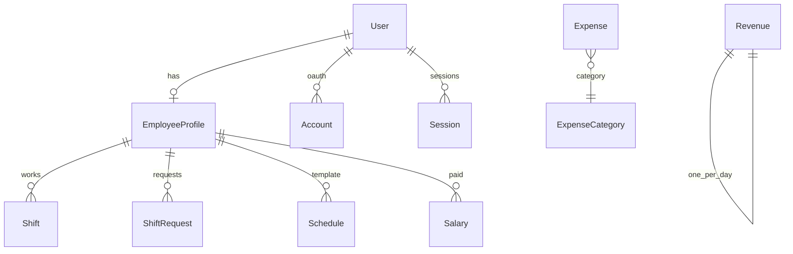

# База данных Wheels

PostgreSQL + Prisma ORM. Схема: `prisma/schema.prisma`.

## ER-диаграмма (основные связи)



## Перечисления (enum)

| Enum | Значения | Назначение |
|------|----------|------------|
| `Role` | `EMPLOYEE`, `ADMIN` | Роль пользователя в системе |
| `ShiftStatus` | `PENDING`, `CONFIRMED`, `REJECTED` | Статус смены или заявки |
| `ExpenseCategory` | `WEIGHTS`, `MATERIALS`, `RENT`, `OTHER` | Категория расхода |

## Таблицы

### User — пользователи (вход в систему)

| Поле | Тип | Описание |
|------|-----|----------|
| `id` | String (cuid) | PK |
| `email` | String, unique | Логин (в нижнем регистре при входе) |
| `passwordHash` | String | bcrypt-хеш пароля |
| `name` | String | Отображаемое имя |
| `role` | Role | `ADMIN` — начальник, `EMPLOYEE` — сотрудник |

**Связи:** один `EmployeeProfile` (опционально), `Account`, `Session` (для Auth.js adapter).

> Админ из seed **не обязан** иметь `EmployeeProfile`. Сотрудники создаются с профилем.

---

### EmployeeProfile — профиль сотрудника

| Поле | Тип | Описание |
|------|-----|----------|
| `id` | String | PK |
| `userId` | String, unique | FK → User |
| `phone` | String? | Телефон |
| `position` | String | Должность, по умолчанию «Мастер» |
| `hourlyRate` | Decimal? | Почасовая ставка (справочно) |

**Связи:** `Shift`, `ShiftRequest`, `Schedule`, `Salary`.

`employeeProfileId` попадает в JWT-сессию сотрудника — без него личный кабинет недоступен.

---

### Shift — подтверждённые/запланированные смены

| Поле | Тип | Описание |
|------|-----|----------|
| `employeeId` | String | FK → EmployeeProfile |
| `date` | Date | День смены |
| `startTime`, `endTime` | String | Формат `HH:MM` |
| `status` | ShiftStatus | Обычно `CONFIRMED` или `PENDING` |
| `comment` | String? | Комментарий |
| `createdBy` | String? | id User (админ), кто создал |

Индексы: по `date`, по `(employeeId, date)`.

---

### ShiftRequest — заявки сотрудника «могу работать»

Структура как у `Shift`, но отдельная сущность до решения админа.

При **подтверждении** (`CONFIRMED`) админом создаётся запись в `Shift` (см. `updateShiftRequestStatus`).

---

### Schedule — шаблон недельного расписания

| Поле | Тип | Описание |
|------|-----|----------|
| `weekday` | Int | 1–7 (Пн–Вс в seed) |
| `startTime`, `endTime` | String | Рабочие часы |
| `isActive` | Boolean | Активен ли шаблон |

Уникальность: `(employeeId, weekday)`.

---

### Revenue — выручка за день

| Поле | Тип | Описание |
|------|-----|----------|
| `date` | Date, **unique** | Один ввод выручки на дату |
| `amount` | Decimal(12,2) | Сумма |
| `comment` | String? | Комментарий |

При повторном вводе за ту же дату — **upsert** (обновление суммы).

---

### Expense — расходы

| Поле | Тип | Описание |
|------|-----|----------|
| `name` | String | Название («Грузики», «Аренда») |
| `amount` | Decimal | Сумма |
| `date` | Date | Дата расхода |
| `category` | ExpenseCategory | Категория для графиков |
| `comment` | String? | Комментарий |

---

### Salary — выплаты сотрудникам

| Поле | Тип | Описание |
|------|-----|----------|
| `employeeId` | String | FK → EmployeeProfile |
| `amount` | Decimal | Сумма выплаты |
| `date` | Date | Дата выплаты |
| `comment` | String? | Например «Неделя 1» |

---

### Account, Session, VerificationToken

Служебные таблицы **Auth.js Prisma Adapter**. При входе через email/пароль (Credentials) основная сессия хранится в **JWT**, не в `Session`. Таблицы нужны адаптеру и возможным OAuth в будущем.

## Расчёт финансов (логика в коде)

В `src/shared/lib/finance.ts` и `src/services/finance.service.ts`:

```
чистая прибыль = выручка − зарплаты − расходы
```

**Сезоны для аналитики:**

- Зимний: с 1 июля по 31 декабря текущего года
- Летний: с 1 января по 1 июля

## Команды Prisma

| Команда | Действие |
|---------|----------|
| `npm run db:push` | Применить схему к БД (без файлов миграций) |
| `npm run db:migrate` | Создать/применить миграции (production) |
| `npm run db:seed` | Тестовые пользователи и данные |
| `npm run db:check` | Проверить подключение и число пользователей |
| `npm run db:studio` | GUI для просмотра таблиц |

## Seed-данные (`prisma/seed.ts`)

После успешного `npm run db:seed` в БД появляются:

| Email | Пароль | Роль |
|-------|--------|------|
| `admin@wheels.local` | `password123` | ADMIN |
| `alex@wheels.local` | `password123` | EMPLOYEE |
| `dmitry@wheels.local` | `password123` | EMPLOYEE |

Также: выручка за ±14 дней, расходы, зарплаты, смены, заявки, шаблоны `Schedule`.

**Без seed вход админа невозможен** — в таблице `User` никого нет.
